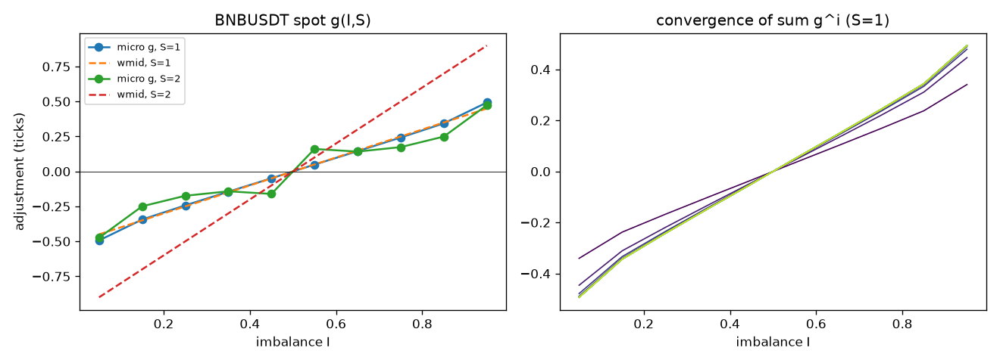
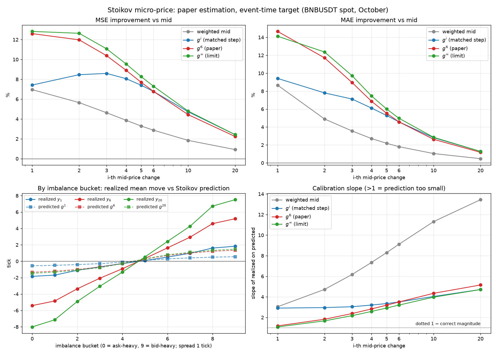
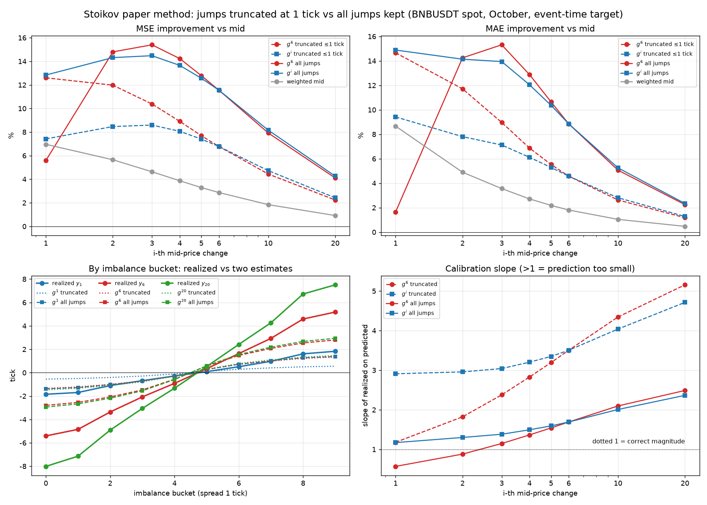
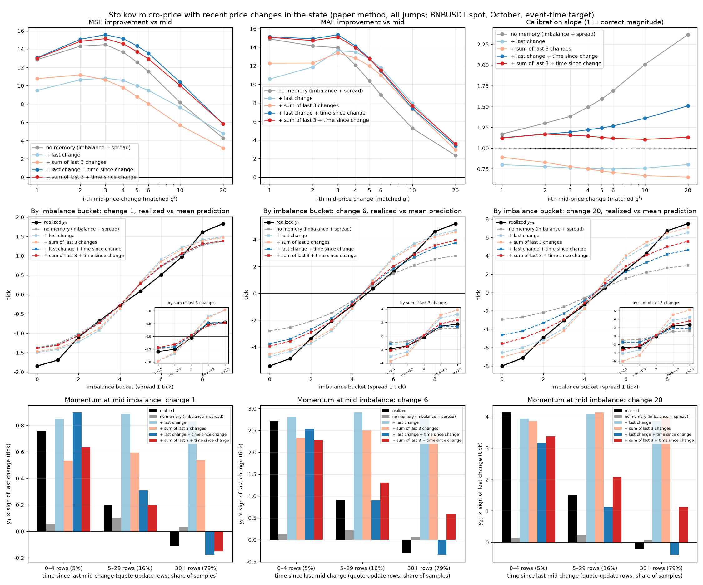
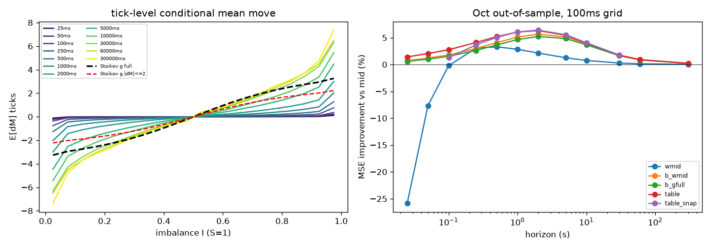
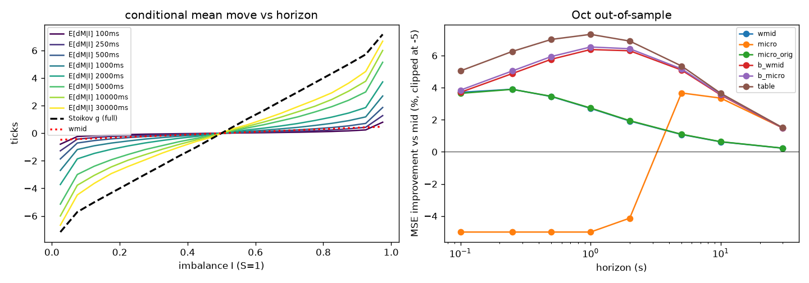

# Stoikov (2018) Micro-Price — Replication on Binance BNBUSDT Spot

Replication of **Sasha Stoikov (2018), "The micro-price: a high-frequency estimator of future prices"**, *Quantitative Finance* 18(12), 1959–1966, on real Binance **BNBUSDT spot** tick data, with two extensions: keeping all jump sizes, and adding recent price changes to the Markov state.

| Item | Setting |
|---|---|
| Data | Binance tick-level L1 `book_ticker` (Jul–Oct 2026, ~250M quote updates) + ~100 ms `book_snapshot_25` |
| Estimation | 2026-07-01 ~ 2026-09-30 |
| Evaluation | 2026-10-01 ~ 2026-10-31 (out-of-sample; this month was used in earlier research, so it is not a pristine hold-out) |
| Units | ticks (1 tick = 0.01 USDT ≈ 0.134 bp at October prices) |

---

## 1. Model

State = (imbalance bucket `I = Qb / (Qb + Qa)`, spread `S` ∈ {1, 2} ticks). From symmetrized one-step transitions:

- `Q`: transitions with no mid change; `R1`: absorbing mid jump of size `K`; `R2`: new state reached after a mid change
- `g¹ = (1 − Q)⁻¹ R1 K`, `B = (1 − Q)⁻¹ R2`, `gⁱ = Σ_{j<i} Bʲ g¹`
- micro-price = `mid + g⁶` (the paper uses 6 steps); `g^∞` is the limit (200 terms)

The paper's jump set is `K = {±0.5, ±1}` tick; transitions with a larger jump are dropped.

### Estimated g(I, S)



Left: `g(I,S)` estimated on 100 ms snapshots. With a 1-tick spread it almost coincides with the weighted mid; the 2-tick spread has very few samples (~140 per bucket) and is noisy. Right: `Σ gⁱ` converges quickly and barely changes after 6 steps, as in the paper.

---

## 2. Paper estimation, paper target (core replication)

Script: `bnb_stoikov_native.py`. One row per L1 quote update, 10 equal-frequency imbalance buckets, evaluated on the paper's **event-time** target: `yᵢ` = mid after the i-th mid change − current mid. 61M October samples.



| i-th mid change | weighted mid | gⁱ (matched step) | g⁶ (paper) | g^∞ |
|---|---|---|---|---|
| 1 | +6.96% | +7.42% | **+12.60%** | +12.83% |
| 3 | +4.63% | +8.59% | +10.38% | +11.07% |
| 6 | +2.87% | +6.78% | +6.78% | +7.30% |
| 20 | +0.92% | +2.42% | +2.24% | +2.42% |

(MSE improvement over predicting an unchanged mid; higher is better.)

- **The paper's result replicates**: the micro-price clearly beats mid and weighted mid at every horizon; daily IC is about 0.37–0.40.
- **But the magnitude is too small**: bottom-left, realized mean moves (solid) are far larger than predictions (dashed); bottom-right, the calibration slope is 1.1–5.2 (1 = correct magnitude).

---

## 3. Extension 1: keep all jump sizes

On BNB spot only 72.8% of tick-level mid jumps are ≤ 1 tick; about 27% are larger (mean 1.32 ticks). The paper's truncation `K ≤ 1 tick` discards them, so `g` is systematically too small. `bnb_stoikov_native.py --all` keeps every jump:



| i-th mid change | gⁱ truncated ≤ 1 tick | gⁱ all jumps |
|---|---|---|
| 1 | +7.42% | **+12.84%** |
| 3 | +8.59% | **+14.48%** |
| 6 | +6.78% | **+11.55%** |
| 20 | +2.42% | **+4.26%** |

Keeping all jumps lowers the calibration slope of `gⁱ` from ~3–4.7 to 1.2–2.4 and roughly doubles the MSE improvement (solid vs dashed lines).

---

## 4. Extension 2: recent price changes in the state (memory)

Script: `bnb_stoikov_memory.py`. On top of (imbalance, spread), add the last mid change, the sum of the last 3 changes, and the time since the last change (in quote-update rows).



- Adding only the last change, or the sum of the last 3, makes things worse: the state space becomes sparse and the model over-extrapolates momentum.
- Adding time since the last change as well (dark blue, dark red) is consistently better than no memory (e.g. i = 4: +13.65% → +15.14%), with calibration slopes closer to 1.
- Bottom row: right after a change (0–4 rows) prices do continue in the same direction; after 30+ rows (79% of samples) the continuation disappears or reverses. Only models with the time dimension can tell these cases apart.

---

## 5. Clock-time horizons

Market making needs the price "h milliseconds later", not "after the i-th change". `g` does not depend on the horizon, so using it directly for short horizons badly overstates the move:



Left: the realized conditional mean move (coloured lines) grows with the horizon, while Stoikov's `g` (black / red dashed) matches only one horizon. Right: October out-of-sample, one scale factor per horizon (`b_gfull`) fixes this; a per-horizon conditional-mean table (`table`) is best, +6.1% at 1 s.



The 100 ms snapshot version shows the same picture: the unscaled `micro` is negative up to 2 s (clipped at −5% in the plot; −489% at 100 ms), while the scaled `b_micro` is positive at every horizon.

---

## 6. Files

| Script | Purpose |
|---|---|
| `bnb_tick_bbo_cache.py` | raw `book_ticker` parquet → per-day tick L1 cache (`.npz`) |
| `bnb_mm_data.py` | raw `book_snapshot_25` → per-day ~100 ms snapshot cache |
| `bnb_spot_microprice.py` | First pass: g(I,S) on 100 ms snapshots, clock-time evaluation |
| `bnb_spot_microprice_scaled.py` | Horizon-scaled micro-price and conditional-mean table |
| `bnb_tick_microprice.py` | Event-time g on tick L1 (paper truncation / all jumps) + 100 ms clock evaluation |
| `bnb_stoikov_native.py` | **Faithful replication**: paper estimation + paper event-time target (`--all` keeps all jumps) |
| `bnb_stoikov_memory.py` | Extension: recent changes and time since last change in the Markov state |
| `*_plot.py` | Figures from the saved JSON results (no recomputation) |

Full result tables are in `results/microprice/*/report.md`.

## 7. Running

```bash
pip install -r requirements.txt
python bnb_tick_bbo_cache.py 2026-07-01 2026-10-31
python bnb_tick_microprice.py
python bnb_stoikov_native.py          # paper version (K <= 1 tick)
python bnb_stoikov_native.py --all    # keep all jump sizes
python bnb_stoikov_memory.py
python bnb_stoikov_native_plot.py
```

Raw data are **not** included. Data and cache paths are hard-coded at the top of each script (`E:/HFT_Data/...`); change them to your own location.

## Reference

Stoikov, S. (2018). The micro-price: a high-frequency estimator of future prices. *Quantitative Finance*, 18(12), 1959–1966. https://doi.org/10.1080/14697688.2018.1489139
